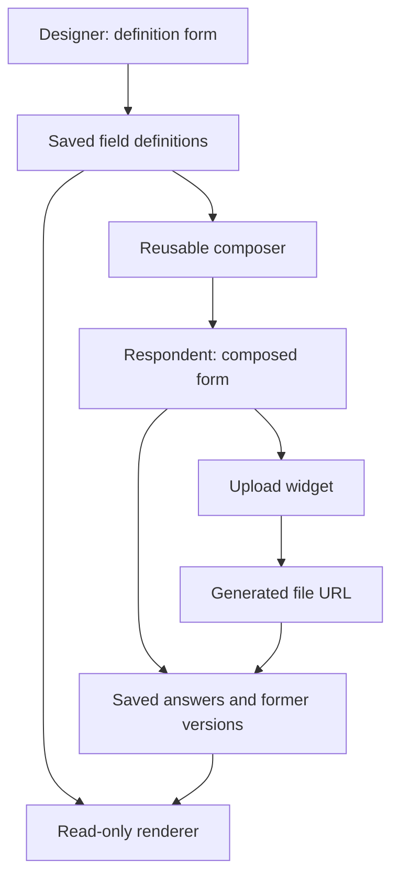

# u5CMS DynaForm: compose forms through forms

[Documentation home](README.md) · [Forms and exports](forms.md)

## Summary

**u5CMS DynaForm** is the method of storing a form's field definitions as ordinary u5CMS form records and using a reusable renderer to compose the answering form. A trusted form designer edits questions through a definition form; respondents fill in the resulting form. Definitions, answers and uploads remain separate. MF/MFS, DAT, version checks and upload widgets supply the surrounding workflow.

**For** solution designers, form authors and administrators. **Version** method documented on 28 November 2026; core primitives reviewed on stable 12.10.14. **Scope** a composition method implemented with CMS page components, not a newly shipped core module, configuration switch or `[dynaform]` command. A new installation needs the composer components as well as the CMS.

## Start with the appropriate level

| Need | Start here |
| --- | --- |
| A fixed contact or registration form | [A first form](forms.md#a-worked-registration-form) |
| Each person returns to one answer | [MF and MFS](forms/mf-mfs.md) |
| Several editable records per person | [Add, edit and delete entries](forms/manage-entries.md) |
| Designers add/reorder questions through another form | DynaForm, this guide |
| Supporting files and generated links | [Uploads](forms/uploads.md) |

For DynaForm, continue with the [field schema and definition-form example](dynaform/schema.md). Identify or implement a compatible renderer before using that example for respondents. Adding its definition page alone does not create an answering application.

## How the components fit together



One definition record describes one question or explanatory block. The composer reads the selected active definitions in their intended order, chooses their language, then emits the appropriate control. The ordinary CMS form handler saves the respondent's answers under the response form's own name. A read-only renderer can combine the same definitions with selected saved answers.

| Component | Neutral example name | Responsibility |
| --- | --- | --- |
| Definition form | `roomcheck!edit` | Add/edit a question's stable name, type, wording, choices and help. Restricted to trusted designers. |
| Definition records | `formdata` rows whose `formname` is `roomcheck!edit` | Store the questions, independently of respondents' answers. |
| Definition list and composer | `roomcheck!rdr` plus a reusable `dynacompose` page | Read the active definitions; expose designer edit links only to authorised designers; render the answering form. |
| Response records | `formdata` rows whose `formname` is `roomcheck!rdr` | Store actual responses and their versions. Use MF, MFS or explicit row editing as designed. |
| Read-only renderer | `roomcheck!view` | Combine authorised response selection with the definitions to display a completed checklist. |
| Upload wrapper | A reusable page around `upload` | Show an existing attachment link and offer replacement through a numbered widget. |

The names above illustrate a component arrangement, not reserved CMS names. Only a **leading** `!` has the core intranet-page meaning; the `!edit`, `!rdr` and `!view` suffixes are this method's naming convention. Set explicit page logins and transaction permissions. An archive flag or an unlinked component is not an access restriction.

## Build or reuse a composed workflow

1. **Record the component inventory.** Locate the definition form, shared composer, answer page, output renderer, upload wrapper and their included scripts/texts. Record their dependencies, PHP execution requirements and login policy. CMS page components are database content: copying the application ZIP alone does not install them.
2. **Choose the response model.** Use MF for a personal revisable response, MFS for a deliberately shared response, or explicit add/edit links for multiple records. Define how a business case or dossier maps to a CMS identity or logical key. Do not silently equate a business key, a username and `formdata.id`.
3. **Create the definition form and its rights.** Use the [documented field schema](dynaform/schema.md). Keep definition editing separate from answering. Definition text may include trusted markup and control attributes, so ordinary respondents must not gain designer rights.
4. **Enter a small example.** Add a `room` INPUT, a `condition` SELECT and an `accessnotes` TEXTAREA. Choose stable machine names and explicit stored option values. Set a definite order before collecting answers.
5. **Connect the renderer.** Select only the intended form's active definitions, in a deterministic order. Read each named value from that record's `headcsv`/`datacsv` pair; do not treat the packed data as independently named database columns. The inspected pattern orders definitions by their `notes` value; its renumbering helper maintains that order. Confirm the local convention before moving questions.
6. **Compose the answering page.** Put the emitted controls inside one ordinary `[fo:]…[:fo]` form, add its submit/thanks behaviour and `firstsaverwins`, then apply the chosen MF/MFS marker. A minimal integration shell is shown below. `dynacompose` stands for the required site component, which must target this form's definition set.

   ```text
   [fo:]
   [fi:]
   [le:]Room handover[:le]
   [$$$:dynacompose]
   [h:]
   <input type="hidden" name="thanks" value="roomcheck!rdr">
   <input type="hidden" name="in2my" value="off">
   <input type="hidden" name="em2cu" value="off">
   <input type="hidden" name="em2me" value="off">
   <input type="hidden" name="firstsaverwins" value="">
   <button type="submit">Save room handover</button>
   [:h]
   [mf][:fi]
   [:fo]
   ```

7. **Add output and attachments.** Reuse the selected definition set for read-only presentation. Use DAT or the local renderer to select the permitted saved response. If attachments are required, include the [appropriate upload widget](forms/uploads.md), keep its numbering stable and save its returned URL with the response.
8. **Run the acceptance cases below.** Open the visitor pages directly, use two ordinary accounts, and examine both form datasets in the backend before widening access.

An existing composer may already supply save controls, notification fields, hooks or MF/MFS. Avoid adding them twice. The example deliberately uses the ordinary CMS save flow; a custom site writer is a separate integration with its own contract.

## Edit questions during everyday use

Use the definition form to add or revise a question; save it, then reopen the answering page and its read-only output. The definition change should appear in the intended language. Check an existing response as well as a new blank response.

Keep machine names and choice codes stable. Change a label from **Room condition** to **Condition at handover** without changing the stored key. Add optional questions first. Reordering ordinary text controls and reordering numbered upload widgets have different consequences: the latter can reassign existing file values to another visible question. Plan that change as a data migration.

Removing a definition does not delete its previously saved answers, history or files. Retire definitions deliberately and preserve a readable interpretation of older responses. A change from MF to MFS is also an access/model change, not a wording edit.

## Upload a file, then produce its link

The inspected composition pattern combines a normal protected `upload` widget with a small wrapper. The wrapper displays a link to the already-saved upload and opens the upload control when a replacement is requested. DAT reads the corresponding `userupload1`, `userupload2`, etc. from the selected current response. A reusable placeholder/counter keeps wrapper IDs distinct when the component appears more than once.

The sequence is **upload → receive URL → save the composed form → retrieve the stored link**. An upload's **OK** indicator confirms only the first part. A visible warning or unsaved-change indicator should make the required form save clear.

For example, a personal latest-response display can select one stored attachment:

```text
[userupload1|roomcheck!rdr|ALL|SELF|1||||id DESC LIMIT 1:dat]
```

This example uses the installation's SELF policy and is appropriate only when that selection matches the response model. A shared MFS answer or keyed case needs its own authorised selection. Keep the standard protected-file routing and test it with the intended readers; a link being displayed does not itself grant download access. See [the upload guide](forms/uploads.md) for the protected/public distinction, numbered fields, save lifecycle and cleanup.

## Check the composed application

| Case | Expected result |
| --- | --- |
| Add one definition through the designer form | It appears once, at the intended position, in both the answering form and its output. |
| Ordinary respondent opens the designer's definition/edit URL | No definition-edit permission is granted by their answering rights. |
| Save, close and reopen a personal answer as Alice and then Bob | MF finds each person's own eligible response. |
| Two authorised readers open a deliberately shared form | MFS shows the common response; stale saves trigger the configured conflict check. |
| Change labels or switch language | Existing answers still match the same machine names and option codes. |
| Add an optional question to a form with older responses | Older responses remain readable; no older value shifts into the new field. |
| Upload two different files; save; reopen; replace only the second | The first link remains unchanged, the second matches its new file, and both have the intended retrieval policy. |
| Submit without completing a required upload or answer | The response is not reported as successfully saved. |
| Open a saved link as another person and signed out | Page, record and file rules enforce the intended model independently. |
| Restore a matching database and file backup | Definitions, answers, history and file links still correspond. |

## Troubleshooting and evidence

| Symptom | Check and next action |
| --- | --- |
| The definition form works, but no questions appear | Check that the composer exists, PHP execution is permitted where required, and its exact definition form/status/order match the saved rows. |
| Another form's questions appear | Check the family/prefix convention and any explicit definition-set selector. Map/validate request-supplied selectors against allowed families. |
| Old answers disappear after a wording change | Check for a changed machine name, option code, response form name, login identity or eligibility status. |
| A dropdown changes meaning after rearranging options | Give options explicit stable codes; implicit positional values change when reordered. |
| Conditional sections initialise incorrectly | Use the post-prefill `starterscript` hook and compose multiple initialisers without redefining the same function. |
| A link exists but its file cannot be retrieved | Check the stored widget value, file existence and protected download rights separately. |

The method was grounded in a read-only inspection of an existing composition implementation: its common definition form, PHP composer, answer shell and upload/link wrappers. No live responses were changed or submitted for that inspection. This public guide uses neutral names and examples. The stable repository supplies the documented form, MF/MFS, DAT and upload primitives; acceptance of a particular composer and hosting configuration remains a separate check.
