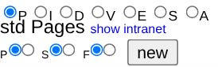
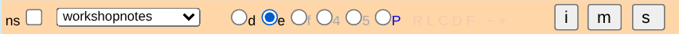

# Create and publish your first page

[Documentation home](README.md)

## Summary

Create a page called `workshopnotes`, write a heading and a meeting place, then open the saved page as a visitor. The page name identifies it in links. You can change the heading later while keeping the same address.

**For** editors with permission to create pages on a practice site. **Version** u5CMS 12.10.5. The language choices come from your installation.

## Create the page

1. Sign in to your site's backend. On a site installed at the web root, the address ends in `/u5admin/`. If the CMS lives in a subdirectory, keep that directory in the address.
2. At the top of the far-right column select **P** (Pages), then **new**. Enter `workshopnotes`. If the name already exists, choose another and use that name throughout.
3. When you see **name is available**, leave **automatically go to the new page** ticked and choose **insert new item**. The middle editor's page selector now shows your page name.



## Write, save and open

1. In that editor choose the radio button for English, or another language configured on your site. Paste these two lines into the large text box.

   ```text
   [[[[Workshop notes]]]]
   Meet at the library on Saturday.
   ```

2. Choose the small **s** in the same editor. Wait for **saved workshopnotes** above the right-hand column.
3. Click the **letter P** beside the language buttons. A new tab shows the heading *Workshop notes* and the sentence below it. Copy this tab's address to share the saved page.



The round control beside **P** changes that editor pane to a preview. To write again, select a language in that pane. The **P** at the top of the far-right column takes you to the list of pages.

## Make it reachable

If you want readers to find the new page from an existing one, add the following line to the **source of the referring page**, then save that page. Follow the link on the website.

```text
[Read the workshop notes:workshopnotes]
```

A direct link, the site menu and the homepage each reach a page in a different way. To add a menu entry or change which page opens at the site's root, follow [Pages, navigation and the homepage](navigation.md).

## If the result differs

| What you see | Where to look |
| --- | --- |
| The source box has disappeared | The pane is showing a preview. Choose the language button beside **P** to return to its source. |
| The visitor page shows text from another language | Reopen the intended language in the editor. An empty field can display the site's first language to visitors. |
| The link opens a different page | Compare the identifier after the colon with the name in the destination's page selector. |

Continue with [headings, formatting and reusable text](editing.md) or [add a picture or a PDF](media.md).
