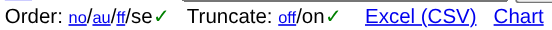

# Forms, stored records and exports

[Documentation home](README.md)

## Summary

Create a workshop registration form, send one name and find it in the CSV export. You will use the page editor, the visitor page and the backend’s **form data** view. The example turns off email notifications.

**For** form authors and installation administrators. **Version** checked on u5CMS 12.10.4 for the complete editor-to-export exercise. Use an account that can create pages and open **Form data** on a practice installation. With the default `$formdataRqHIADRI` setting, access to the form-data area requires higher administration rights (HIADRI).

## A worked registration form

1. Sign in to the backend. In the far-right column choose **P** (Pages), then **new**. Enter `docform` and wait for **name is available**. Leave **automatically go to the new page** ticked and select **insert new item**. The middle editor opens the new page. If the name is already in use, choose a fresh name and use it throughout the exercise.
2. In the editor whose page selector shows `docform`, select the radio button for English. Paste the whole example below into its large text box.

```text
[fo:]
[fi:]
[le:]Workshop registration[:le]
[h:]
<input type="hidden" name="thanks" value="documentationSaved()">
<input type="hidden" name="in2my" value="off">
<input type="hidden" name="em2cu" value="off">
<input type="hidden" name="em2me" value="off">
<label for="participant">Your name</label>
<input id="participant" name="participant_mandatory">
<button type="submit">Register for the workshop</button>
<p id="submission-status"></p>
<script>
function documentationSaved() {
    document.getElementById('submission-status').textContent =
        'Your registration was saved.';
}
</script>
[:h]
[:fi]
[:fo]
```

3. Choose the small **s** button in that editor to save. Wait for **saved docform** above the right-hand column. Click the **letter P** beside the language buttons to open the saved page in a new tab. The round control beside that letter opens the editor preview.

## View and export the result

1. On the visitor page, leave **Your name** empty and select **Register for the workshop**. The required field prevents the submission. Enter a made-up name, submit again and wait for **Your registration was saved.**
2. Return to the backend tab. In the far-right column choose **S** (Save history & Special funcs). Open the **special funcs** view if needed, then select **form data**. Find the row for `docform` and follow **html**. New responses appear under **1) new**.
3. In that view, select **Excel (CSV)**. Open the download as UTF-8 with a semicolon delimiter. Find your test value in the `participant*` column. The file should contain one data row if this was the form's first successful submission.



## Choose what to do with the records

| What you want readers or editors to do | Next guide |
| --- | --- |
| Review responses, then publish the approved rows | [Survey tutorial](forms/survey-results.md) |
| Add, edit or withdraw their own entries | [Contributor list (Scenario 2)](forms/manage-entries.md) |
| Browse a directory and open a single record | [Display records with DAT](dat.md) |
| Answer a survey across two pages | [Multipage survey](forms/multipage-surveys.md) |
| Receive a personalised message based on their response | [Serial mail](serial-mail.md) |

## What the exercise demonstrated

| Attempt | Observed result |
| --- | --- |
| Empty mandatory field sent to the real handler | Rejected; no record inserted. |
| Extra field absent from the stored form source | Rejected; no record inserted. |
| Valid browser submission | Callback ran and exactly one record was inserted. |
| Value `Zürich – 東京 🙂` | Preserved in the actual backend data view and UTF-8 CSV export. |

The server validates field names against the stored form source. An extra client-side field is not automatically part of the accepted form contract. Correct mismatched names rather than disabling that check to suppress an error. Translated labels can differ; machine field names must remain consistent across languages.

The CMS form markers connect the form to u5CMS. The HTML supplies the label, field name and submit button. The `_mandatory` suffix requests mandatory-field validation. The `thanks` field selects the completion action; it can also name the site's existing confirmation page instead of a callback.

Use one native `[fo:]` wrapper per page. The example uses a JavaScript callback to display the confirmation on the same page. When adapting an existing form, keep its notification choices unless you intend to change who receives mail.

Filtering a view changes which rows you see. The account and ownership rules still apply to the selected records.

The internal `formdata.datacsv` representation contains CMS-specific separators and escaped values. It is not the finished export. During the exercise, inspecting that raw value without the normal decoding initially obscured the Unicode text. The CMS's own table view and CSV endpoint reproduced the original value correctly. Use those supported paths for ordinary viewing and exchange.

For ownership, see [SELF permissions](permissions.md). For a custom persistence routine, the technical [site-writer reference](onlymine.md#form-specific-storage) explains its explicit marker, fixed function and required result. Forms without that marker retain the built-in writer.

## Protect public submissions with Turnstile

Configure the site's actual widget keys before enabling protection:

```php
$requireturnstileonfrontendformsave = 'yes';
$u5turnstilesitekey = 'YOUR_SITE_KEY';
$u5turnstilesecret = 'YOUR_SECRET_KEY';
```

Include `grc.php` within each protected form using the installation's existing template integration. The server checks the token; hiding a submit button is only the visible part of the flow. Current widgets keep their own completion, expiry and reset state when more than one protected HTML form is present.

The legacy `$requiregooglerecaptchaonfrontendformsave = 'yes';` setting also requires server verification. Protected installations must supply current Turnstile keys. To deliberately disable verification, disable or remove both protection settings. The [protected-form release notes](https://github.com/u5cms/u5cms/blob/v12.9.5.13/docs/release-12.9.5.13.md#protected-forms) explain the compatibility boundary.

## Optional archived sender evidence

Ordinary forms can leave `$formSenderEvidenceRequired` unset or `'no'`. The separate `saml-archive-v1` mode requires an authenticated SAML archive, signing configuration, schema provisions and compatible append-only forms. Custom writers, payment submissions and per-user version-checked replacement flows need separate compatibility review and can be rejected by that mode.

The current local regression exercised ordinary and enabled modes, identity/archive failures, view restrictions, uncertain delivery and incompatible forms. It did not authenticate against a live identity provider. Follow the complete [authenticated-messaging setup and acceptance procedure](authenticated-messaging.md) before enabling the mode on a real installation.
