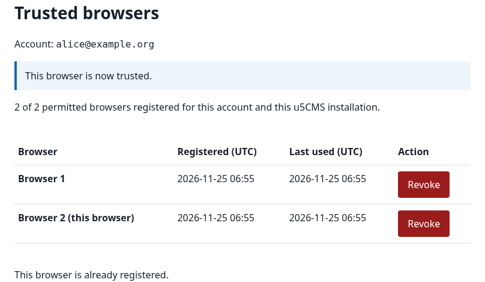

# Trusted Device: a practical exercise

[Documentation home](../README.md) · [Trusted Device](../trusted-browsers.md)

## Summary

This exercise separates three things that are easy to confuse: an ordinary CMS session, a browser's persistent credential and its numbered registration in the database. Use a disposable installation and two independent browser profiles, A and B.

**For** account holders and testers. **Version** 12.10.0 with the same-origin form correction. **Scope** a disposable two-profile exercise.

## 1. Give one account two places

Ask the installation administrator to configure:

```php
$u5trusteddeviceenabled = 'yes';
$u5trusteddeviceusers = array('alice@example.org' => 2);
```

Sign in as Alice in A and register it. Repeat in B. Both pages now show **2 of 2 permitted browsers** and identify their own current browser. A third profile can sign in normally but cannot register until a place becomes free.

The allowance counts registrations in this installation. It does not count open tabs, conversations or physical computers.

## 2. Distinguish session expiry from logout

Close A's tab and reopen the management page in A. The registration remains. In the automated exercise, removing only the ordinary `u` and `p` session cookies also allowed the real authentication hook to restore Alice from the separate trusted credential.

Now use **CMS logout** in A. Returning requires normal authentication, and A's old registration is gone. B retains its own registration. Logout therefore cannot be used to demonstrate ordinary session expiry: it deliberately withdraws the credential being tested.

## 3. Lose a profile without freeing a place

Register A again, then clear A's site cookies in this disposable installation. Sign in normally once more. The server still reports two registrations, but A is no longer marked **(this browser)**.

From B, revoke A's obsolete numbered place. A can now register again. Losing the credential and deleting the server record are separate events; that distinction explains many apparently full allowances in cloud-browser use.

## 4. Try temporary and permanent withdrawal

With A registered, temporarily disable the feature. Resumption stops. Re-enable it without revoking the record: the retained credential can resume again.

Then use **Revoke** for the current profile. The existing ordinary session can still display the account, but the persistent credential has been withdrawn. Permanent withdrawal and immediate termination of every active session are separate operational tasks.

## Observed results

The local HTTPS/Chromium walkthrough passed 19 scenarios, including host-alias separation, independent allowances, account switching, invalid limits, origin checks and CSRF rejection. It used the actual management page, ordinary login endpoint and production authentication hooks with disposable accounts and a real MariaDB database. It did not contact AGOV, a cloud-browser service or a production CMS.

An initial run exposed a real form failure: `Referrer-Policy: no-referrer` caused Chromium to send `Origin: null` on the page's own POST. The origin guard correctly refused it. Using `Referrer-Policy: same-origin` allows that same-origin form to supply its origin while withholding referrers from other origins. The repeated exercise then passed; cross-origin submissions and incorrect CSRF tokens still received HTTP 403.



To reproduce the exercise with your own disposable local database, see [the documentation laboratory](../labs/README.md).
